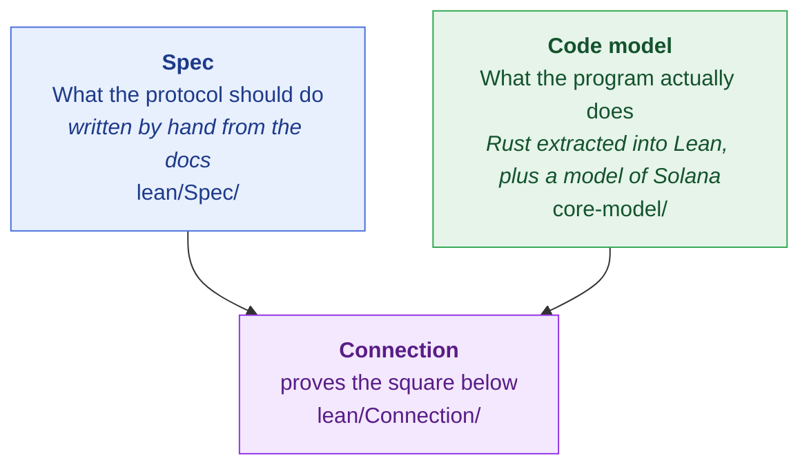

# How to review the verification

You review **statements**, not proofs: Lean checks the proofs. Check that each statement says
what we think it says, and that nothing important is assumed away.

## Review path

1. **Spec goals**: `lean/Spec/Statements.lean`, the security goals G1–G5 and the trusted
   assumptions T0–T3. Start here: everything after shows the code meets these goals.
2. **Overview**: the section below and `CONNECTIONS.md`.
3. **The connection** (`lean/Connection/`): read `ConnectionTheorems.lean` top to bottom. Look
   up each mapping (`Mapping.lean`) and hypothesis (`Hypotheses.lean`) where a statement first
   uses it; the theorems are only as meaningful as these. Then `CodeModelStatements.lean`: the
   spec's goals stated of the code. Then `Findings.lean`: the differences found (L1, A0).
4. **Core-model, which the theorems trust**: see "What to check".
5. **Build** (below).

Do not read `lean/Spec/Proofs.lean` or `lean/Connection/Proofs/`.

## The connection in brief

**The three parts.** The spec says what the protocol should do. The code model is what the
program actually does. The connection proves the two agree.



**What is proved: two connection theorems.**

1. `transact_connection`, one transaction. `toWorld` maps a chain state to a spec world;
   `toInputs` maps an instruction to the spec's transaction inputs. Whenever the code accepts a
   `transact`, the spec's `transact` relates the two mapped worlds:

$$
\begin{array}{cccl}
{\color{#0969da} s} & {\color{#0969da} \xrightarrow{\quad \mathrm{step}(\mathit{tx}) \quad}} & {\color{#0969da} s'} & \qquad {\color{#0969da} \textsf{(code model)}} \\[6pt]
\Big\downarrow{\scriptstyle \mathrm{toWorld}} & & \Big\downarrow{\scriptstyle \mathrm{toWorld}} & \\[6pt]
{\color{#1a7f37} \mathrm{toWorld}(s)} & {\color{#1a7f37} \xrightarrow{\quad \mathrm{transact}(\mathrm{toInputs}(\mathit{tx})) \quad}} & {\color{#1a7f37} \mathrm{toWorld}(s')} & \qquad {\color{#1a7f37} \textsf{(Lean spec)}}
\end{array}
$$

   All the spec's preconditions hold, and the effects are exactly the spec's.

2. `run_connection`, a whole execution. Every execution of the code model from genesis, read
   through the mapping, is a run of the spec.

$$
\begin{array}{cccccccccl}
{\color{#0969da} \mathrm{genesis}} & {\color{#0969da} \xrightarrow{\ \mathrm{initialize}\ }} & {\color{#0969da} s_0} & {\color{#0969da} \xrightarrow{\ e_1\ }} & {\color{#0969da} s_1} & {\color{#0969da} \xrightarrow{\ e_2\ }} & {\color{#0969da} \cdots} & {\color{#0969da} \xrightarrow{\ e_n\ }} & {\color{#0969da} s_n} & \qquad {\color{#0969da} \textsf{(code model)}} \\[6pt]
& & \Big\downarrow{\scriptstyle \mathrm{toWorld}} & & \Big\downarrow{\scriptstyle \mathrm{toWorld}} & & & & \Big\downarrow{\scriptstyle \mathrm{toWorld}} & \\[6pt]
& & {\color{#1a7f37} \mathrm{initWorld}} & {\color{#1a7f37} \xrightarrow{\ \mathrm{spec}\ }} & {\color{#1a7f37} \mathrm{toWorld}(s_1)} & {\color{#1a7f37} \xrightarrow{\ \mathrm{spec}\ }} & {\color{#1a7f37} \cdots} & {\color{#1a7f37} \xrightarrow{\ \mathrm{spec}\ }} & {\color{#1a7f37} \mathrm{toWorld}(s_n)} & \qquad {\color{#1a7f37} \textsf{(Lean spec)}}
\end{array}
$$

   Each $e_i$ is a program instruction or anything else the chain allows. Each bottom arrow is
   a spec `transact` or a change the spec allows between transactions.

Soundness is shown for the whole `step`. Completeness (the code accepts what the spec allows)
is shown for the program's own logic (the handler, `handler_complete_except_L1_A0`), except
for the found differences L1 and A0, and for `step` in G3a and G3b. `ConnectionTheorems.lean`
opens with a table of what each direction covers.

**The spec's goals, stated of the code.** Each goal from step 1 is stated again of the code,
using the spec's own property (`NoDoubleSpend` becomes `noDoubleSpend_code`).

| Goals | Code theorems | From |
|---|---|---|
| G1a, G1b, G1c, G1d, G5a, G5b | `spendsAreGenuine_code`, `noDoubleSpend_code`, `poolBacksNotes_code`, `onlyOwnerSpends_code`, `onlyAuthoritiesChangeConfig_code`, `adminPowersLimited_code` | `run_connection` |
| G2a, G4a, G4b | `samePayout_code`, `onlySignersPay_code`, `exactPayouts_code` | `transact_connection` |
| G3a, G3b | `honestSpendIsAccepted_code`, `adminsCannotLockWithdrawals_code` | handler completeness (`handler_complete_except_L1_A0`), assuming Anchor's account checks pass (`ReachesProgram`); L1 and A0 excluded |

Not carried over: G2b (about circuit witnesses only).

**A difference between code and spec makes a theorem fail.** Lean then proves the faithful
statement false, with a counterexample (`Findings.lean`). No statement gets an extra
condition to make it provable.

**What the theorems rely on** (`Hypotheses.lean`: what links the code to the spec; `CodeModelAssumptions.lean`: about the code alone):

| Kind | What | Your job |
|---|---|---|
| Premise | the scenario: an execution from genesis, the code accepted | Check it describes the situation, not a restriction |
| Assumed | linking: `HashesAgree`, `CompletenessAssumptions` (with code parts); about the code: `DeploymentFacts`, `SolanaFacts`, `CryptoFacts`, `PairingLaws` and the syscall contracts, `ExecutionAssumptions`, Anchor's constraints in `ReachesProgram`; core-model's own assumptions | Check each is true of the real system |
| By design | `OutsideSpecDetail`, `ExecutionOutsideSpecDetail`: Solana details the spec deliberately does not model | Check each is below the spec's level and harmless |

G3 also has the owner's choices and the limits from the spec's G3. Each hypothesis is labelled
with its kind in the statement. Any condition without one is suspect.

**Non-vacuity.** A theorem "if H then C" says nothing if H can never hold, and Lean does not
warn about it. So every theorem is covered by a `…_nonvacuous` theorem: a small example in
which all its hypotheses hold. The examples use a *toy* deployment, with deliberately fake hashes and
pairing: they show the hypotheses are consistent, not that they are true of the real system
(that is your job above). No security claim rests on a toy.

## What to check (steps 3–4)

For every statement on the review surface: does its docstring say exactly what the formula
says?

**`ConnectionTheorems.lean`**
- *Connection theorems.* The code side must be the code model itself: `step`, `Run`,
  `Genesis` from `core-model/`, not something redefined in `lean/Connection/`. Every hypothesis
  must be a premise (the execution, the accepted step) or a named bundle from
  `Hypotheses.lean`. Any other condition is suspect: it may hide a difference.
- *Completeness* (`handler_complete_except_L1_A0`): does it exclude only L1 and A0, and as
  narrowly as the counterexamples in `Findings.lean`?
- *Non-vacuity.* The conjuncts must be exactly the hypotheses of the theorem they cover,
  none dropped or weakened.

**`CodeModelStatements.lean`**
- *Goals of the code* (`…_code`). The conclusion must be the spec's own property, applied
  unchanged (`LeanSpec.Goals.NoDoubleSpend …`, defined in `Spec/Statements.lean`), not a property
  rewritten for the code, which could be weaker. The hypotheses must be those of the connection
  theorem in the table above.
- *Non-vacuity.* The conjuncts must be exactly the hypotheses of the theorem they cover,
  none dropped or weakened.

**`Findings.lean`**
- Each counterexample: does the spec allow the transaction, while the code rejects it?

**`Hypotheses.lean`, `CodeModelAssumptions.lean`**
- *Assumed* fields: true of the real system, for the reason the docstring gives? A false
  assumption voids every theorem that uses it.
- Could any field exclude a case an attacker can reach? That would hide a bug.
- *By design* (`OutsideSpecDetail`): is each detail really below the spec's level?

**`Mapping.lean`**
- Do the maps match the program? Field elements big-endian and read mod p; addresses
  little-endian; nullifier accounts count as 0 in balances (`publicBalance`).
- Is the spec's verifying key the program's (`programKey`)?
- `IsRunOf`: is the spec run the execution's own? Check the start (pool address, rents, admin, what
  `initialize` set up), each transaction's pool balance before and state after, and the admin
  instructions with their signers (`ExecutionPath`, `toAdminChange`, `ExecutionView`).

**Core-model, which the theorems trust**
- `EnvStep` (`core-model/PrivacyCash/Model/Execution.lean`): nothing outside the program
  changes the owner or data of its accounts. Double-spend protection rests on it.
- The syscall contracts and the hand-written Solana and Anchor model
  (`core-model/README.md`, "Assumptions").

## Checking the proofs are real

```bash
cd formal-verification
nix develop path:. -c bash -c "cd lean && lake build"
```

The build must succeed with no `sorry` warning from `Connection/`. To see what a theorem
relies on, add `#print axioms Connection.run_connection` to a scratch file and run it with
`lake env lean`. Only `propext`, `Classical.choice` and `Quot.sound` are acceptable.

## Reporting

A problem in a statement, a hypothesis that seems false, or a missing finding: add it to
`TODO.md` with the theorem or field name.
